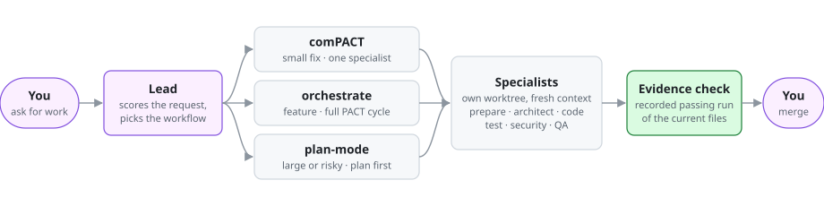
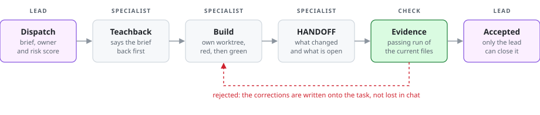

<div align="center">

# rePACTed

**Your Claude Code session becomes a small engineering team.**

[](pact-plugin/CHANGELOG.md)
[](LICENSE)
[](#requirements)
[](#install)
[](https://github.com/Synaptic-Labs-AI/PACT-Plugin)

</div>

> rePACTed is a fork of **[PACT](https://github.com/Synaptic-Labs-AI/PACT-Plugin)**, the agent team for Claude Code created by **[Professor Synapse](https://github.com/ProfSynapse)** at **Synaptic Labs** and built out by **[MJ Wojcik](https://github.com/michael-wojcik)**, its most active contributor. The core idea is theirs: a lead that runs a team of specialists through **P**repare, **A**rchitect, **C**ode and **T**est. rePACTed adds a task system with evidence checks, guards, a task log that lives in your repo, autopilot and a knowledge base. [Full credits ↓](#credits)

You describe the work. A **lead** sizes it and hands the pieces to **specialists**, each in its own git worktree. The lead accepts each piece only with test evidence, and **nothing merges without you.**

```
/plugin marketplace add v4lheru/repacted-plugin
/plugin install repacted@repacted
```

---

## How it works

<picture>
  <source media="(prefers-color-scheme: dark)" srcset="docs/assets/how-it-works-dark.svg">
  
</picture>

The lead scores every request, so a typo fix doesn't get the whole cycle and a risky change doesn't skip the plan.

---

## What's inside

| Feature | What it does for you |
|---|---|
| **[Task system](docs/concepts/task-files-and-waits.md)** | Every piece of work is a task with an owner, a brief and a status, saved on disk, not in chat. Corrections are written onto the task, so none get lost in the scrollback. |
| **[Teachback](docs/concepts/teachback.md)** | Before a specialist starts, it says the brief back in its own words. A misunderstanding is caught before any code is written. |
| **[Evidence-checked handoffs](docs/concepts/handoff.md)** | A finished task comes with a report (a HANDOFF). Code is accepted only with a recorded passing test run of the files as they are now. For a fix or a feature, a failing run must come first. |
| **Protected task state** | Task files are guarded, so a specialist can't mark its own work as done by rewriting the file. Only the lead accepts. |
| **[Parallel worktrees](docs/concepts/worktrees.md)** | Each feature gets its own git worktree, and each specialist starts with a fresh context. Two features are built at once without touching each other's files. |
| **Task log in your repo** | `.repacted/tasks.jsonl`, plus a readable `docs/progress.md`. Come back next week, run `repact work`, and the lead takes the next open task. |
| **Autopilot** | `/repacted:autopilot` works through the task log on its own and stops when the list, the clock or the budget runs out. A task it can't finish is parked for you, not faked. |
| **Change receipt** | `repact inspect <id>` shows what changed, which tests back it, and what is still open. |
| **Decision inbox** | `repact decide` lists every question that waits on you, each with the command that answers it. |
| **[Guards](docs/concepts/guards.md)** | These stop a leaked secret, a commit that holds a credential, and a force-push, merge or branch delete you didn't approve. Each refusal says why and what to do instead. |
| **[Memory and knowledge base](docs/kb.md)** | Decisions and lessons go into a memory the lead can query. The optional knowledge base turns past sessions into lessons that you review before they are kept. |
| **Cost control** | A one-line cost preview before a workflow, and a spend cap per session in your team policy. |
| **Team policy** | One file per repo that can only tighten the rules, never loosen them. Bring your own specialist agents if you need them. |
| **Packs** | Add a domain as a second plugin. An n8n pack ships today. |
| **Unattended CI** | A recipe that runs comPACT on a labelled GitHub issue and stops at a draft pull request for a person to review. |
| **Telegram (optional)** | Progress and questions can reach your phone. |

---

## A task's life

<picture>
  <source media="(prefers-color-scheme: dark)" srcset="docs/assets/task-life-dark.svg">
  
</picture>

Specialists run as plain subagents by default, or as Agent Teams if you turn that on. The task works the same way in both modes.

---

## Pick the right amount of process

| Request | Lead's score | Workflow | What happens |
|---|:-:|---|---|
| "Fix the off-by-one in the pager" | 4-6 | `/repacted:comPACT` | One specialist, one test, done. |
| "Add a config file for defaults" | 7-10 | `/repacted:orchestrate` | Prepare → Architect → Code → Test, with specialists in parallel where it's safe. |
| "Move auth to a new provider" | 11-14 | `/repacted:plan-mode` | Specialists are consulted, a plan is written, and work starts once you approve it. |

The score adds up four ratings from 1 to 4: novelty, scope, uncertainty and risk.

---

## Install

In Claude Code:

```
/plugin marketplace add v4lheru/repacted-plugin
/plugin install repacted@repacted
```

Then open your project and run:

```
/repacted:init --repo
```

Init shows a diff and changes nothing until you say yes. Every file it changes is first copied to `<file>.bak-<time>`. Restart Claude Code, then try **`/repacted:demo`**: the lead fixes a failing test in a scratch copy of a toy project ([what happens](docs/examples/first-run.md)).

Don't turn on rePACTed and the original PACT plugin together: both would run their hooks on every event.

<details>
<summary><b>From a shell, pin a version, or use Agent Teams</b></summary>

From a shell: `claude plugin marketplace add v4lheru/repacted-plugin` and then `claude plugin install repacted@repacted`.

**Pin a version.** `/plugin marketplace add` has no option for a tag, so clone a release tag and add the folder instead:

```
git clone --branch repacted--v2.1.0 https://github.com/v4lheru/repacted-plugin.git ~/repacted-plugin
claude plugin marketplace add ~/repacted-plugin
claude plugin install repacted@repacted
```

Keep that folder: the plugin runs from it.

**Agent Teams.** To run specialists as Agent Teams (an experimental Claude Code feature), use `/repacted:init --repo --teams`. Ask Claude to run `repact-doctor` and look for the `execution:` line: `subagents (default)` or `teams (REPACT_EXECUTION=teams)`.

**Specialists will not spawn?** If a spawn is refused with `no task dispatched`, the lead must first run the `repact dispatch` command the refusal prints. More in [troubleshooting](docs/troubleshooting.md#if-specialist-agents-will-not-spawn).

</details>

---

## Every day

At the first session, the plugin puts a `repact` command in `~/.local/bin`. Each command also works as a slash command.

| Command | What it does |
|---|---|
| `repact work "<ask>"` | Start work on an ask. With no ask, take the next task from the log. |
| `repact inspect [id]` | Where the work stands, or one task's change receipt. |
| `repact decide` | Every question that waits on you. |
| `repact resume` | Pick up the last session. |
| `/repacted:comPACT` | A small, self-contained change, done by one specialist. |
| `/repacted:orchestrate` | A feature through the full cycle. |
| `/repacted:plan-mode` | A plan first, for large or risky work. |
| `/repacted:autopilot` | Work through the task log until the list, the clock or the budget runs out. |
| `/repacted:peer-review` | A review of finished work before you merge. |

```
/repacted:comPACT backend add a --verbose flag to the greet command
/repacted:orchestrate add a config file that sets the default greeting
```

---

## See a guard work

Ask Claude to `Run cat .env`. You don't need a real `.env` file: the guard refuses the command before it runs.

```
env_guard: Blocked: this would print the contents of .env (a .env-class file) into the transcript; [...]
→ Pass the value to the command that needs it with `env-get FILE KEY -- <command>`; do not print the file. [rule: env.read.operand]
```

Every refusal has the same shape: **what** was refused and why, **→ what to do instead**, and the **rule id**. `repact inspect --refusals` shows the recent ones. The [guards page](docs/concepts/guards.md) lists every guard, and what each one does not cover.

---

## More

<details>
<summary><b>Build a knowledge base</b></summary>

`repact-distill` turns notes the agents already wrote, and if you allow it your lead session transcripts, into proposed lessons for a folder you own. It is off by default (`distill.enabled`). A dry run shows what it would read and what it would cost, and sends nothing. It can send through `claude -p`, the Anthropic API or the Batch API. You or the lead review the proposals one at a time or 20 at a time, and you can promote accepted lessons into a repository for your team. Read the [knowledge base guide](docs/kb.md) first: it covers privacy, cost, and what to check before you distill work sessions.

</details>

<details>
<summary><b>Packs</b></summary>

A pack is a second plugin in the same marketplace that adds skills and specialists. The first one adds n8n skills and a `pact-n8n` specialist that builds workflows over the n8n REST API:

```
/plugin install repacted-n8n@repacted
```

</details>

<details>
<summary><b>Run comPACT unattended in CI</b></summary>

A recipe and a workflow template run `/repacted:comPACT` on a labelled issue in GitHub Actions and stop at a draft pull request that a person reviews. Read the [unattended CI recipe](pact-plugin/docs/recipes/unattended-ci.md) before the first run: it covers the setup, what limits the run, and what it costs.

</details>

<details>
<summary><b>Hook latency</b></summary>

Hooks run on every tool call. On a recent Mac (Apple silicon, Python 3.14, 30 recorded runs), a Bash call adds about 250 ms at p50: the time its two hook processes take, from start to exit. `repact-report` prints p50 and p95 for each hook from your own sessions, and CI fails if a hook slows down past its budget.

</details>

<details>
<summary><b>Uninstall</b></summary>

```
claude plugin uninstall repacted@repacted
claude plugin marketplace remove repacted
```

Uninstall also deletes the plugin's data folder; add `--keep-data` to keep it. The commands below remove what stays behind. The original PACT plugin uses the same `pact-sessions` folder and may use the same link names, so the lines that would also remove its files are commented out. If you don't use PACT, remove the `#` before running them. If you do, check where the links point first (`ls -l`) and keep `pact-sessions`.

```
C="${CLAUDE_CONFIG_DIR:-$HOME/.claude}"
rm -rf "${XDG_STATE_HOME:-$HOME/.local/state}/repacted"     # lock files for CLAUDE.md writes
# find "$C/agents" -name 'pact-*.md' -type l -delete    # links to the plugin's agents
# rm "$C/protocols/pact-plugin"                          # link to its protocols
# rm -rf "$C/pact-sessions"                              # session journals and state
```

- **The managed block in each repository you used:** the lines from `<!-- PACT_MANAGED_START` to `<!-- PACT_MANAGED_END -->` in `.claude/CLAUDE.md`.
- **Settings that init changed:** restore them from the `.bak-` copies, or remove them by hand:
  - `CLAUDE_CODE_ENABLE_TODO_TOOLS` and the allow rules init added to your user `settings.json`;
  - `CLAUDE_CODE_EXPERIMENTAL_AGENT_TEAMS` and `REPACT_EXECUTION`, if you used `--teams`;
  - the `repact` file in `~/.local/bin`;
  - with `--repo`: the `"agent"` line in `.claude/settings.json`, the `.repacted/` folder, and the `.repacted/tasks.jsonl merge=union` line in `.gitattributes`.

</details>

---

## Requirements

- **Claude Code CLI.** Version 2.1.302 is tested, locally and in CI. Other Claude Code apps are not tested.
- **Python 3.9 or newer** as `python3` on your `PATH`, and **git**.
- **macOS** (tested) or **Linux** (expected to work). On Windows, use WSL (expected to work, not tested). Native Windows is not supported, because the hooks need POSIX file locks.

## Learn more

[Quickstart](docs/quickstart.md) · [Concepts](docs/concepts/index.md) · [Glossary](docs/glossary.md) · [Troubleshooting](docs/troubleshooting.md) · [Knowledge base](docs/kb.md) · [Changelog](pact-plugin/CHANGELOG.md)

---

## Credits

rePACTed stands on **[PACT-Plugin](https://github.com/Synaptic-Labs-AI/PACT-Plugin)**. Thank you to:

- **[Professor Synapse](https://github.com/ProfSynapse) / Synaptic Labs**, who created PACT and the Prepare, Architect, Code, Test method behind it.
- **[MJ Wojcik](https://github.com/michael-wojcik)**, PACT's most active contributor by far.
- Everyone else who contributed to PACT.

rePACTed is an independent fork of PACT v4.8.1 (commit `0cd9e88b`). It is maintained by [Uros Pesic](https://github.com/v4lheru) and is not affiliated with or endorsed by Synaptic Labs. PACT's MIT license is kept unchanged in [LICENSE](LICENSE); see [NOTICE](pact-plugin/NOTICE.md).

## Contributing, security, license

- [CONTRIBUTING](CONTRIBUTING.md): sign-off, and which files take pull requests here.
- [SECURITY](SECURITY.md): report a vulnerability privately.
- [Code of conduct](CODE_OF_CONDUCT.md).
- MIT License: see [LICENSE](LICENSE) and [NOTICE](pact-plugin/NOTICE.md).
