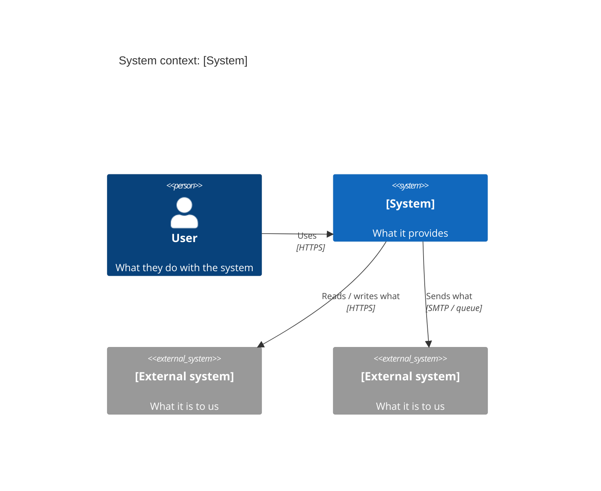
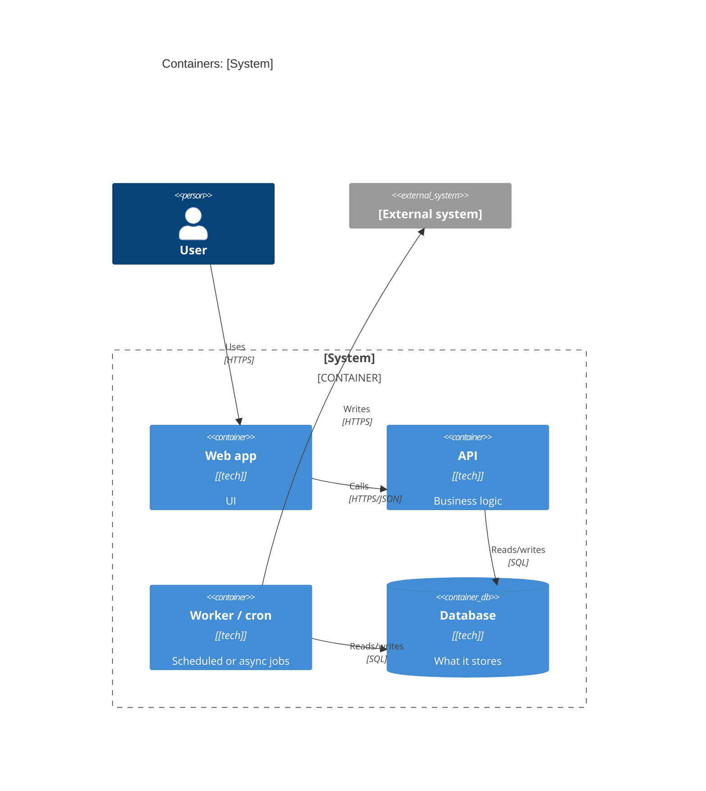

# C4 sketch (context and container)

Context: the minimum an architect needs to draw a system context view and a container view in a
design doc, plus the decision-record stub and the sections this skill adds (consumers,
degradation). Copy the parts you need; Mermaid C4 renders in most viewers, and the ASCII form
works everywhere.

## Level 1: system context

Your system as one box, its people, and the external systems it talks to. Label every arrow
with its purpose and protocol.



## Level 2: containers

Separately deployable or runnable units (web app, API, worker, cron job, database, queue).
**Draw every entrypoint, including cron jobs and batch workers**: they are the second consumers
that change-impact reviews miss.



ASCII fallback:

```
            [User]
              | HTTPS
+-------------v---------------------------------+
| [System]                                      |
|  [Web app] --HTTPS--> [API] --SQL--> [DB]     |
|                         ^             ^       |
|  [Worker/cron] ---------+-------------+       |
+------------------------|----------------------+
                         v
                 [External system]
```

## Checks before the diagram is done
- The system boundary is explicit; every person and external system is shown.
- Every arrow has a purpose and a protocol.
- Every container that reads or writes the thing you are changing is on the diagram, including
  jobs whose only trigger lives in deploy config.
- Technology is named per container. Keep it small enough to read in one screen.

## Design-doc sections this skill adds
```markdown
## Consumers of <field / table / endpoint>
| Consumer | Kind (interactive / scheduled / export / cache) | Checked how | Not checked (why) |

## Degradation behaviour
| Condition (empty read, over cap, upstream error, partial run) | What the system does | What the operator sees |
```

## Decision record stub
```markdown
## Decision <n>: <title>
Status: proposed | accepted | superseded by <n>
Context: the forces, and which consumer the decision is argued for.
Decision: what we will do.
Alternatives: each with the reason it lost.
Consequences: what gets easier, what gets harder.
Revisit when: a falsifiable trigger, written also at the code site it concerns.
```
